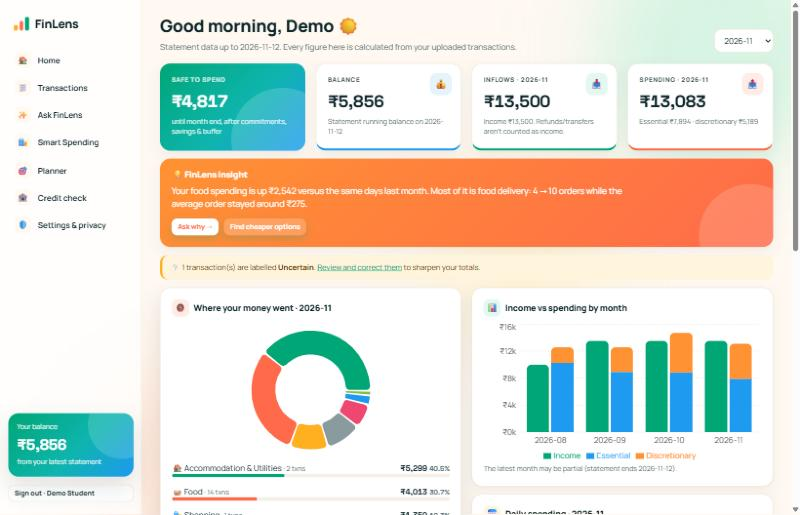
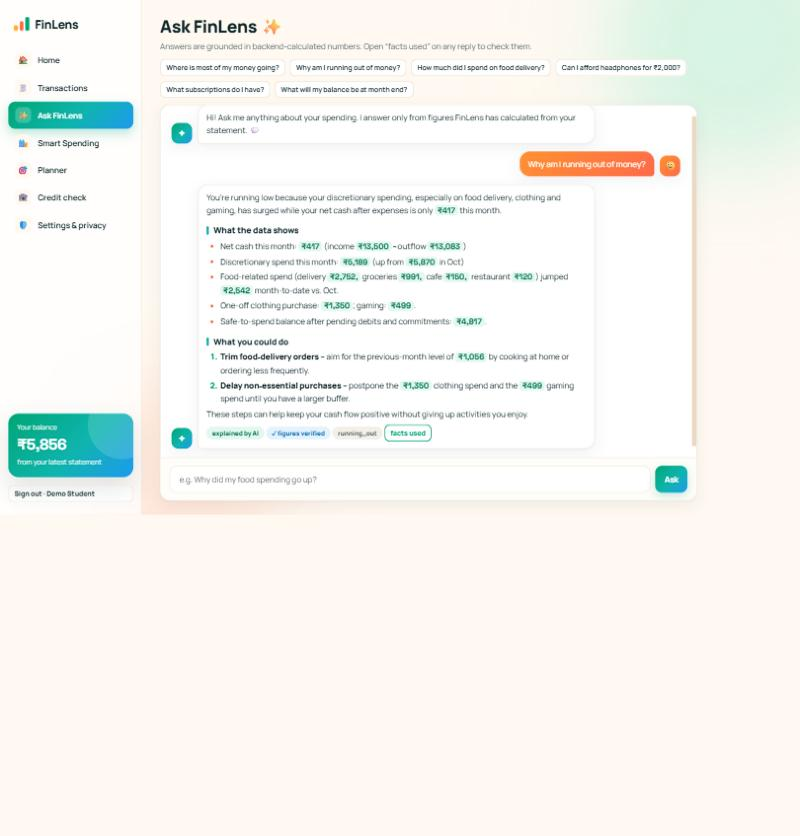
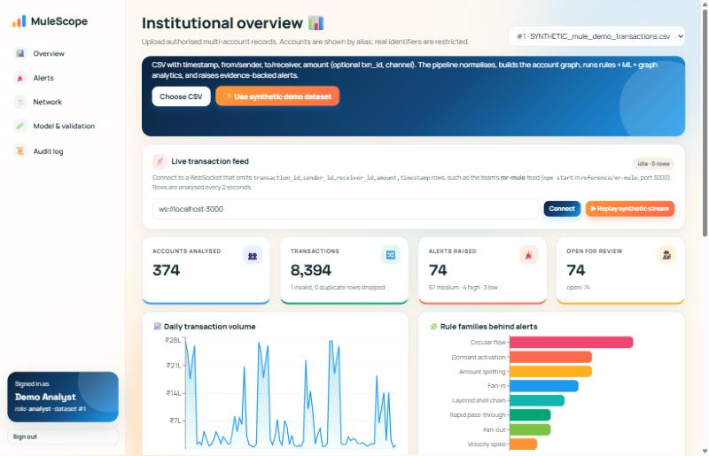

<div align="center">

# 💸 FinLens & 🕸️ Money Mule Detection

**Help people understand their money. Help institutions investigate suspicious money.**

ZeroHour · Track 1 (Quantitative Finance, FinTech & Risk Analytics) · Team **CodeBlooded**

`Python 3.13` · `FastAPI` · `React 18 + Vite` · `XGBoost / scikit-learn` · `NetworkX` · `Cytoscape.js` · `Recharts` · `Groq LLM` · `SerpAPI` · `Sarvam AI (Hindi · ಕನ್ನಡ · voice)`

</div>

---

Two **independent** fintech products built from the project blueprint. They share engineering code but **no customer data, logins, databases or encryption keys**.

| | 💸 **FinLens** (B2C) | 🕸️ **Money Mule Detection: MuleScope** (B2B) |
|---|---|---|
| **For** | Students, young professionals, individuals | Banks, fraud analysts, compliance teams |
| **Does** | Spending insights, money health, AI explanations in English/Hindi/Kannada with voice, smart-spending recommendations with a budget guard, goal planning, nudges and a weekly report, splitting with friends (with payback detection), cash-flow credit affordability and a credit-builder path | Multi-account transaction monitoring, live streaming with instant alerts, graph and temporal pattern detection, explainable alerts, money-trail replay, human-in-the-loop investigation |
| **API** | `finlens/` → <http://localhost:8001/docs> | `mule/` → <http://localhost:8002/docs> |
| **UI** | <http://localhost:5173/finlens> | <http://localhost:5173/institution> |
| **Store** | `data/stores/finlens.db` (own key) | `data/stores/mule.db` (own key) |

> ⚠️ **Prototype, decision support only.** It is not a registered Account Aggregator, lender, adviser or bank system. Demo data is **synthetic** and labelled as such. The models are trained on large public datasets (IBM AMLworld simulation, real Lending Club loans); their metrics are benchmark results, **not** proof of performance on real Indian bank data.

---

## 📸 Screenshots

| FinLens dashboard | Ask FinLens (verified figures) |
|---|---|
|  |  |
| **Smart Spending (live listings)** | **Credit check: cash-flow score + what-if** |
|  |  |
| **MuleScope overview** | **Network investigation (clusters)** |
|  |  |
| **Alerts** | **Alert evidence** |
|  |  |

---

## 🚀 Quick start

### Prerequisites
- **Python 3.13** (3.11+ should work) and **Node.js ≥ 18**
- Optional: a **Groq API key** (LLM), a **SerpAPI key** (live shopping and restaurant search) and a **Sarvam AI key** (Hindi/Kannada and voice). Without them the app still works, with template answers, a labelled demo catalog and English only.

Full details: [`docs/REQUIREMENTS.md`](docs/REQUIREMENTS.md).

### 1. Install

```bash
python -m pip install -r requirements-dev.txt
```

```bash
npm --prefix frontend install
```

### 2. Configure

Copy `.env.example` to `.env` and fill in what you have:

```ini
GROQ_API_KEY=your_groq_key
SERP_API=your_serpapi_key
SARVAM_API_KEY=your_sarvam_key
```

`.env` is git-ignored; never commit real keys.

### 3. Run everything (Windows, one command)

```bash
powershell -ExecutionPolicy Bypass -File .\start.ps1
```

On first run this generates the synthetic data, trains the models, starts both APIs and the frontend, and opens the browser.

<details>
<summary>…or start each service manually (any OS)</summary>

```bash
python -m ml.generate_finlens_samples && python -m ml.train_mule_model && python -m ml.train_credit_model
```

```bash
python -m uvicorn finlens.main:app --port 8001
```

```bash
python -m uvicorn mule.main:app --port 8002
```

```bash
npm --prefix frontend run dev
```

Optional, the mr-mule test sender for MuleScope's external live feed (port 3000):

```bash
npm --prefix tools/mr-mule install
```

```bash
node tools/mr-mule/server.js
```

Open <http://localhost:5173>.
</details>

### 4. Log in

| Portal | Login |
|---|---|
| FinLens | Click **Create account** (any email/password) and complete the 2-minute profile, or use a demo account from [`data/samples/DEMO_ACCOUNTS.md`](data/samples/DEMO_ACCOUNTS.md) (local database only) |
| MuleScope | `analyst` / `analyst-demo-2026` or `lead` / `lead-demo-2026` (change via `.env`) |

---

## 🎬 Demo walkthrough

**FinLens** (blueprint §14):
1. Create an account, grant **Spending analytics** consent, then **Try the synthetic sample statement** (or drop your own CSV/PDF).
2. **Home:** balance, inflows/spending, category donut, safe-to-spend maths, recurring payments, month-end forecast, spending calendar, and a grounded insight. For example: *"food delivery: 4 → 10 orders, average order unchanged"*.
3. **Money health + For you:** Home opens with an honest verdict (healthy / steady / tight / at risk) and proactive nudges (category pace, bills due, price rises, double charges, goals, paybacks). Nothing says "you're running out" unless the numbers do.
4. **Ask FinLens:** "How am I doing this month?" or "Can I afford a ₹1.5 lakh laptop?". Answers are formatted and every ₹ figure is verified. Switch to **हि / ಕ** in the sidebar for Hindi or Kannada, use 🎤 to speak and 🔊 to listen.
5. **Smart Spending:** "biryani for 4 people around 1200". You get five real listings, ranked, with per-person budgets. Type an impossible budget (e.g. 7888888) and it asks *"Are you sure?"* with a typo guess before searching.
6. **Planner:** add a goal with a deadline to see pace, the monthly amount needed and alternative plans; **Weekly report** gives the week vs last week, a day-by-day chart, a win and a focus (printable).
7. **Friends & splits:** split a bill so only your share counts; after a big payment, FinLens spots friends' transfers that add up to an even split and asks *"Were they paying you back?"*.
8. **Spend Guard:** open **Spend Guard → Live input → ▶ Start the day**. Twelve bank SMS arrive one by one (metro, chai, an SMS fee, sunglasses charged twice, Dream11, a 4th Swiggy order, a collect-request scam, a late-night unknown merchant). Watch the pop-ups, then see **Today**, **Insights**, **Wishlist**, **Plan** and **Make it mine**. Paste your own bank SMS too.
9. **Credit check:** affordability with stress tests, the cash-flow score, the built-in lender model, and a **credit-builder path** for first-timers with approval odds over 0–24 months.

**MuleScope:**
1. Log in as `analyst`, then **Use synthetic demo dataset**. About 8,400 transactions are normalised and turned into an account graph, then rules, the ML model and graph analytics run.
2. **Overview:** volumes, rule families, **fraud-ring candidates**, **Export JSON**, and **live monitoring**: start the built-in simulator (90 days of normal history, then live traffic with injectable fan-in, pass-through, cycle, smurfing and structuring patterns), type manual transactions, or connect the external **mr-mule** feed (`tools/mr-mule`, a visual money map with one-click patterns). New alerts pop up as toasts.
3. **Alerts**, then open a **high** alert: evidence sentences, indicators, AI evidence summary, 2-hop network rings, timeline, notes and status.
4. **Network:** separate clusters per flagged account or ring (stars, chains, cycles); on an alert, **▶ Replay money trail** animates the money moving edge by edge.
5. Log in as `lead` to record final dispositions, reveal a real account identifier (with a logged reason) and view the **Audit log**.
6. Optional: on Overview, upload `data/samples/mule_demo_labels_for_evaluation.csv` to measure precision, recall and false-positive rate.

---

## ✨ Features

### 💸 FinLens

| Capability | Highlights |
|---|---|
| **🚦 Spend Guard** | Watches every rupee as it leaves, using **pasted bank SMS** (UPI/card/NEFT/ATM; OTPs ignored, collect-request scams flagged), quick add, or a **live demo day**. Every payment is tagged **need / depends / want** from *your* rules, profile (deliveries per week, budget per meal), history and past regrets. Wants get an instant alert costed in **your** terms (days of goal saving, hours of work, days of pocket money, or your own unit like "plates of biryani"). Needs stay silent. Also: daily traffic-light limit, category caps (50/80/100%), bill shield, "Was this you?" fraud and double-charge alerts with RBI/1930 steps, "where did my money go today?" with voice, before-you-pay check, 48-hour think-twice wishlist with price check, worth-it/regret learning, want tax + round-up jar, small-leak finder, hidden bank charges, habit patterns, subscription review, emergency-fund meter, festival and event planner (reserved in safe-to-spend), streaks and badges, accountability buddy and friend reminders via WhatsApp text. **Make it mine:** coach tone (gentle / straight / tough love), sensitivity, quiet hours, your own need/want grid and every threshold |
| **Personal profile** | 2-minute onboarding wizard: student / working / both, age, pocket money, salary, stipend, payday, living situation, area, fixed costs, goal with deadline, diet, cuisines, sizes, priorities, optional CIBIL. Everything below is tailored to it |
| **Goal-driven planning** | Goals have deadlines and a pace (ahead / on track / behind, expected-vs-saved marker). Goal savings are reserved before "safe to spend"; budgets tighten while a goal is behind; every purchase shows how many days of goal saving it costs; unrealistic plans get a realistic date |
| **Ingestion** | CSV (auto column mapping, Type+Amount or Debit/Credit), **PDF via PyMuPDF + pdfplumber** (tables, bank lines, UPI-app statements), de-duplication, reversal netting, encrypted storage |
| **Categorisation** | 8 blueprint categories plus *Uncertain*; **credits are not automatically income** (refund, own-transfer, borrowed and P2P are separated); user corrections stick per merchant |
| **FinLens AI** | Dashboard metrics, month-to-date like-for-like changes with count-vs-value breakdown, recurring detection, safe-to-spend, forecast with 80% range, goals planner |
| **Ask FinLens** | The backend picks and computes metrics, then the LLM explains. **Every ₹ figure is verified**; on a mismatch the model gets 3 tries, then a template answer. Formatted Markdown answers, chat-only scrolling |
| **Smart Spending** | Knows your money: suggests a comfortable budget (usual spend, daily room until payday, goal) and challenges unrealistic ones ("₹4,000 is 83% of your safe-to-spend, so is it for a group?"). Food search uses your area and diet, expands shorthand ("fast" → fast food), filters out non-food places and adds **Zomato per-person prices**. Conversational slot filling, live **Google Maps / Google Shopping** via SerpAPI (cached, timestamped, linked), top-5 ranking (budget 40 · rating 30 · preference 20 · availability 10), savings estimates, never purchases |
| **Credit Intelligence** | Cash-flow features, reducing-balance EMI and schedule, affordability rule, **5 stress tests**, status + factors + illustrative loans, risk band from a model trained on **1.32M real Lending Club loans** (side signal, with that band's real default rate), **CredWise 300–850 score with what-if**, and a **built-in lender-approval model** (92% accurate on 10k test applications) with factor explanations, a credit-score curve and "largest loan likely to be approved" |
| **Money health** | One honest verdict (healthy / steady / tight / at risk) from savings rate, runway, month-end projection and goals. Every screen and AI answer follows it: FinLens never says "you're running out of money" to someone who isn't, and the "Ask" suggestions change with it |
| **Budget guard** | A budget above your balance, above your safe-to-spend, or implausible for the item (e.g. a typo like ₹78,88,888 for shoes) is **never searched** until you confirm "yes, no mistake" or pick a corrected amount (typo guess + comfortable amount as one-tap buttons) |
| **Nudges & weekly report** | Proactive cards: category pace vs your usual month (softened when you're comfortable), tight days ahead, bills due, price rises, possible double charges, goals behind/ahead, money arrived → pay yourself first, big payments, no-spend streaks, income vs profile mismatch; dismissible. A printable weekly report: week vs last week, day-by-day chart, categories, biggest payment, win of the week and next week's focus |
| **Friends & splits** | Friends, shared expenses (even or custom), settle-ups, balances. Statement suggestions for shared-looking bills and person-to-person transfers. **Payback detection**: after an unusually large payment, the next ~10 incoming transfers are checked; if some add up to the friends' part of an even split (½, ⅔, ¾ …), FinLens asks "were they paying you back?" and one tap records the split and settlements. Split bills count **only your share**; paybacks don't count as income |
| **Credit-builder path** | For first-timers: stage (new / thin / building / established), personalised steps (secured card sized from your safe-to-spend, your own recurring bill on the card, utilisation cap in ₹, autopay, no application sprees), a saved checklist, and approval odds over 0 / 6 / 12 / 24 months from the built-in lender model |
| **Hindi · ಕನ್ನಡ · voice** | Language switch in the sidebar; Ask FinLens, Smart Spending, nudges, report and credit steps are translated with **Sarvam AI** (mayura); voice input (saarika STT) and read-aloud (TTS) |
| **Privacy** | Per-purpose consent, Fernet encryption at rest, minimal LLM context, delete data / delete account |

### 🕸️ Money Mule Detection

| Layer | Details |
|---|---|
| **Rules** | Fan-in/out (24h), rapid pass-through (≥80% forwarded within 60 min), temporal cycles (≤5 hops, ≤72h), amount splitting (₹45k–50k), dormant activation, velocity spikes. From **MuleGuard**: layered shell chains, 72h smurfing, high-volume-merchant false-positive suppression |
| **ML** | XGBoost trained on **31.9M IBM AMLworld transactions** + INR scenarios, 25 vectorised scale-free features (`mule/model_features.py`) |
| **Graph** | PageRank, clustering, linked alerts within 2 hops, fraud-ring candidates with risk scores |
| **Prioritisation** | **No score averaging.** *High* = ML ≥ threshold **and** ≥2 rule families; *medium* = either; *low* = 1 rule family and ML ≥ ½ threshold. Every alert states why it got its priority (e.g. "model + 1 pattern (high needs 2 patterns)"). The ML score only counts on datasets with ≥200 transactions and ≥30 accounts, because its features are relative to the dataset; on smaller ones (e.g. a few mr-mule payments) alerts come from the rules only and the score shows "not used" |
| **Investigation** | Evidence sentences, AI summary (neutral), ego graph, account trail, timeline, notes, status workflow (final dispositions are lead-only), Markdown report, JSON export, audit log, aliased IDs with lead-only reveal |
| **Live** | Built-in **live simulator**: loads 90 days of normal account history (same behaviour as the model's INR training generator, so ordinary shops and people aren't flagged), then streams one simulated hour per tick and injects fan-in/out, pass-through, cycle, smurfing and structuring on demand. Alerts arrive over a WebSocket as **toasts**; the network view **replays the money trail** edge by edge. Manual transactions and an external **mr-mule** WebSocket feed are also supported; the bundled mr-mule page (`reference/mr-mule`, port 3000) shows a live money map with animated ₹ coins, transaction cards, per-account in/out bars and one-click fan-in / pass-through / cycle / structuring patterns. Measured on a 72-hour simulated window: 24 of 28 injected mule accounts caught, 10 false alarms among ~430 accounts |

---

## 🏗️ Architecture

```
            ┌──────────────────────── React (Vite :5173) ────────────────────────┐
            │      /finlens/* (green UI)                /institution/* (blue UI)   │
            └──────────┬───────────────────────────────────────────┬─────────────┘
                 /x-fin proxy                                /x-inst proxy
                       │                                           │
   ┌───────────────────▼──────────────────┐   ┌────────────────────▼────────────────────┐
   │ FinLens API (FastAPI :8001)          │   │ Money Mule API (FastAPI :8002)          │
   │ ingestion → categoriser → analytics  │   │ normalise → graph + temporal features   │
   │ assistant (Groq) · smart spending    │   │ rules + MuleGuard patterns + XGBoost    │
   │ (SerpAPI) · credit (EMI/stress/ML)   │   │ rings · alerts · notes · audit · live   │
   │ consents · encryption                │   │ roles · aliases · encryption            │
   └───────────────────┬──────────────────┘   └────────────────────┬────────────────────┘
              finlens.db (own key)                         mule.db (own key)
                       └──────── shared/ : CODE ONLY (validation, crypto, LLM client) ┘
```

**Separation rules (blueprint §08):** separate databases, secrets and encryption keys; tokens carry an audience and are rejected by the other API (tested); no AML signal can reach the credit module.

---

## 📊 Training data & measured results

Both models are trained on **large public datasets**. The trained models ship in `ml/artifacts/`, so you only need this to retrain. Install the extras, download the data (~6 GB into `data/external/`, git-ignored) and retrain:

```bash
python -m pip install -r requirements-train.txt
```

```bash
python -m ml.download_datasets
```

```bash
python -m ml.train_credit_lendingclub
```

```bash
python -m ml.train_mule_ibm
```

```bash
python -m ml.train_lender_model
```

### 🕸️ Money-mule detector (XGBoost, 712 trees)
**Training data:** [IBM AMLworld](https://github.com/IBM/AML-Data) **HI-Medium**: 31.9M transactions, 1.76M accounts, 41,857 laundering-involved (Altman et al., NeurIPS 2023, CDLA-Sharing-1.0). It is mixed with 10 INR-style scenarios (12,954 accounts, up-weighted) so the model also fits the app's Indian-payments domain. Features come from `mule/model_features.py` (25 vectorised, scale-free features; the same code scores uploads in the app).

| Evaluation set (never trained on) | Accounts | **PR-AUC** | Random | ROC-AUC | Precision@100 |
|---|---|---|---|---|---|
| IBM **HI-Small** (separate world) | 422,734 | **0.227** | 0.015 | 0.856 | **1.00** |
| IBM **LI-Small** (separate world, low illicit) | 576,781 | **0.069** | 0.009 | 0.782 | **1.00** |
| Unseen INR scenario (seed 2) | 967 | **0.992** | 0.103 | 0.999 | 0.96 |
| App demo file (seed 3) | 374 | **0.981** | 0.107 | 0.996 | n/a |

In the app, alerts on the demo file reach **precision 0.88, recall 0.93 and 1.5% FPR** (`POST /api/datasets/{id}/evaluate`).

### 🏛️ Lender-approval model (XGBoost, monotonic): replaces the CredWise API
**Training data:** 50,000 realistic loan applications (US & Canada, *synthetic*, mimicking lender rules; includes students). The label is a lender's **approve/decline** decision. Only scale-free features are used (credit score and history, adverse records, debt/loan/payment/savings-to-income, occupation, product, purpose); interest rate is excluded.

| Untouched test set (10,000 applications) | Accuracy | ROC-AUC |
|---|---|---|
| **Deployed** | **92.2%** | **0.982** |
| Students only | 92.8% | 0.987 |
| Logistic regression | 86.4% | 0.943 |

In the app: approval likelihood, the factors helping or hurting this applicant, approval at different credit scores, the largest loan likely to be approved, and a warning when "a lender might approve" disagrees with FinLens's affordability check.

### 🏦 Repayment-risk model (XGBoost, monotonic)
**Training data:** **1,322,289 real finished Lending Club loans** (2007–2018, CC0). The label is *charged off vs fully paid*, an actual repayment outcome. Features are only ratios FinLens can compute: EMI/income, existing debt/income, total debt/income and term. Interest rate, grade and loan-to-income are excluded to avoid hidden leakage of Lending Club's own risk grade.

| Out-of-time test: 375,145 loans issued in 2015 | ROC-AUC | PR-AUC | Brier |
|---|---|---|---|
| **Deployed** (FinLens ratios, monotonic) | **0.672** | **0.351** | 0.151 |
| Benchmark with credit-bureau fields (FinLens can't see these) | 0.724 | 0.404 | 0.145 |
| Constant baseline | 0.500 | 0.202 | 0.162 |

Real 2015 default rate by band: **lower 11.3% · moderate 16.5% · higher 32.8%**. Cross-check on Home Credit (307k applicants, different country): ROC-AUC 0.52, so the model does **not** transfer; this is documented.

| Other modules | Result |
|---|---|
| Categoriser | 45/45 on a small self-written labelled set (optimistic; real labelled data needed) |

Model cards: [`docs/MULE_MODEL_CARD.md`](docs/MULE_MODEL_CARD.md) · [`docs/CREDIT_MODEL_CARD.md`](docs/CREDIT_MODEL_CARD.md) · [`docs/LENDER_MODEL_CARD.md`](docs/LENDER_MODEL_CARD.md). Earlier synthetic-only baselines: `docs/*_SYNTHETIC.md`.

> AMLworld is IBM's large-scale **simulation**; no public real-bank AML data exists. Lending Club is real but US-based, so treat the credit band as indicative for Indian users.

---

## 🔌 API overview

Interactive docs: <http://localhost:8001/docs> and <http://localhost:8002/docs>.

<details>
<summary><b>FinLens API</b> (port 8001)</summary>

| Method | Path | Purpose |
|---|---|---|
| POST | `/api/auth/register`, `/api/auth/login` | Consumer accounts |
| GET / POST / PUT | `/api/me`, `/api/consents`, `/api/settings` | Profile, per-purpose consent, buffer/opening balance/commitments/location |
| POST / GET | `/api/statements` | Upload CSV/PDF · list uploads |
| GET / PATCH | `/api/transactions`, `/api/transactions/{id}/category` | List/filter · correct category |
| GET | `/api/dashboard`, `/api/forecast`, `/api/categories` | Metrics, forecast |
| POST | `/api/whatif` | Planned-purchase check |
| GET / PUT | `/api/profile` | Personal profile (onboarding wizard) |
| GET | `/api/spending/room` | Spending room: safe-to-spend, daily room until payday, suggested budgets, goal status |
| GET / POST / PATCH / DELETE | `/api/goals[/{id}]`, `POST /api/goals/{id}/deposit` | Savings goals with pace; add savings |
| POST | `/api/ask` | Grounded Q&A (with figure verification) |
| POST | `/api/spending/message`, `/api/spending/reset` | Smart Spending conversation |
| POST / GET | `/api/credit/assess`, `/api/credit/score`, `/api/credit/lender-model`, `/api/credit/emi` | Affordability, cash-flow score, existing-model bridge, EMI |
| POST | `/api/guard/sms`, `/api/guard/quick`, `/api/guard/demo/next`, `/api/guard/demo/reset` | Live input: bank SMS, quick add, demo day |
| GET / POST / PUT | `/api/guard/today`, `/alerts`, `/alerts/{id}`, `/rules`, `/settings`, `/natures` | Today, alerts and answers, need/want rules, personalisation |
| GET / POST / DELETE | `/api/guard/check`, `/wishlist[/{id}]`, `/reflect`, `/jar/move`, `/insights`, `/subscriptions/{key}`, `/buddy` | Before-you-pay, wishlist, regret check, jar, insights, buddy text |
| GET | `/api/money-health`, `/api/nudges`, `POST /api/nudges/{id}/dismiss`, `/api/report/weekly` | Money-health verdict, proactive nudges, weekly report |
| GET / POST / DELETE | `/api/split`, `/api/split/friends`, `/api/split/entries`, `/api/split/settle`, `/api/split/payback` | Friends, shared expenses, settle-ups, payback confirmation |
| GET / POST | `/api/credit/builder`, `/api/credit/builder/{step}/toggle` | Credit-builder path and checklist |
| POST | `/api/voice/stt`, `/api/voice/tts` | Speech-to-text and text-to-speech (Sarvam) |
| DELETE | `/api/data`, `/api/account` | Delete data / account |
| GET | `/api/meta`, `/api/sample-statement` | Config status, synthetic sample |
</details>

<details>
<summary><b>Money Mule API</b> (port 8002)</summary>

| Method | Path | Purpose |
|---|---|---|
| POST / GET | `/api/auth/login`, `/api/me` | Investigator login (analyst / lead) |
| POST / GET / DELETE | `/api/datasets[/{id}]` | Upload and analyse · list · delete (lead) |
| POST | `/api/datasets/live`, `/api/datasets/{id}/append`, `/api/datasets/{id}/reanalyse` | Live feed ingest, re-run detection |
| POST / GET / WS | `/api/live/start`, `/api/live/{id}/stop`, `/inject`, `/tx`, `/status`, `ws /ws/live/{id}` | Built-in live simulator and push alerts |
| GET | `/api/datasets/{id}/trail?account=` | Time-ordered money trail for replay |
| GET | `/api/datasets/{id}/overview`, `/alerts`, `/rings`, `/graph`, `/export.json` | Investigation views and export |
| GET | `/api/datasets/{id}/accounts/{alias}` | Account trail |
| POST | `/api/datasets/{id}/accounts/{alias}/reveal` | Lead-only real-identifier reveal (audited) |
| GET / POST | `/api/alerts/{id}`, `/notes`, `/status`, `/summary`, `/report` | Alert evidence, case work, AI summary, report |
| POST | `/api/datasets/{id}/evaluate` | Precision/recall vs a labels CSV |
| GET | `/api/audit`, `/api/meta`, `/api/sample-dataset` | Audit log (lead), model metrics, synthetic sample |
</details>

---

## 📁 Project structure

```
PESHACK1/
├── finlens/              B2C API: ingestion, pdf_statement, categorizer, analytics (incl. money health),
│                         assistant, smart_spending, amounts, search, profile, goals, room, nudges,
│                         split, credit, credit_features, lender, credit_builder, sms, guard, db
├── mule/                 B2B API: features (rules/graph), patterns (MuleGuard port), model_features,
│                         detection (3 layers), live (simulator + WebSocket hub), db
├── shared/               Code-only foundation: config, security (PBKDF2, tokens, Fernet), normalize,
│                         llm (Groq client), sarvam (translation + voice), dbutil (SQLite WAL / Postgres)
├── ml/                   Dataset downloader, real-data trainers (train_mule_ibm, train_credit_lendingclub), synthetic generators
│   └── artifacts/        Trained models + metrics JSON (committed)
├── frontend/             React 18 + Vite + Recharts + Cytoscape (FinLens + MuleScope)
├── data/
│   ├── samples/          Synthetic CSV/PDF statements, mule demo data + labels, demo accounts
│   ├── external/         Downloaded public datasets + feature cache (~6 GB, git-ignored)
│   ├── generated/        Regenerable synthetic data (git-ignored)
│   └── stores/           Runtime databases (git-ignored)
├── tests/                77 pytest tests (offline)
├── docs/                 REQUIREMENTS, model cards, reference integration, screenshots
├── tools/mr-mule/        Team's mr-mule live sender with a visual money-map page (port 3000)
├── reference/            Read-only clones of the team's repos (git-ignored)
├── requirements*.txt     Pinned runtime deps · -dev adds pytest · -train adds dataset/training extras
├── start.ps1             One-command launcher (Windows)
└── .env.example          Configuration template
```

---

## 🧪 Testing

```bash
python -m pytest
```

The tests cover:
- EMI and amortisation maths, safe-to-spend (the blueprint example equals ₹3,000)
- ingestion (duplicates, reversals, credit kinds, both CSV layouts, three PDF layouts with PyMuPDF and pdfplumber)
- traceable totals, categorisation, consent gates, category corrections, goals, credit status and stress tests
- the Smart Spending conversation and budget guard (typos, budgets above balance, group orders), the figure verifier, token separation between products
- Spend Guard: bank SMS formats and scams, a full live demo day (needs silent, wants personalised, duplicate/fraud/scam/cap/fee alerts), teaching rules, regret learning, before-you-pay, wishlist, jar, festival reserve
- money health, nudges, the weekly report, splits and payback detection, the credit builder, voice endpoints without a key
- a consistency audit: amounts written as "1.5 lakh"/"25k", goal pace near deadlines, achieved goals, forecasts on short statements, EMIs counted once, pass-through shares
- mule rules (fan-in, pass-through, temporal cycles, shell chains, smurfing), priority rules, the small-dataset model guard, rings and JSON export, live append and the live simulator over WebSocket, roles, identifier reveal and the audit log

Tests run offline: API keys are disabled inside the test session.

---

## 🧩 Reuse of the team's existing projects

| Repo | What was reused |
|---|---|
| [`muleguard`](https://github.com/SamratSK/muleguard) | Shell-chain, smurfing and merchant-suppression detectors, ring risk scoring, JSON export format, live mode, Cytoscape layout approach |
| [`mr-mule`](https://github.com/SamratSK/mr-mule) | Live WebSocket CSV feed, accepted directly by MuleScope's live ingest. A copy with a new visual page (money map, animated payments, pattern buttons) is in `tools/mr-mule/`; the server protocol is unchanged |
| [`cred-wise`](https://github.com/SamratSK/cred-wise) | 300–850 cash-flow score with what-if, UPI-PDF parsing heuristics, spending heatmap. Its loan-approval API is no longer available, so FinLens has its **own built-in lender model** (the old API can still be plugged in via `LOAN_API_BASE_URL` for comparison) |

None of the repos contained trained model files or datasets, so both models were trained on large public datasets (IBM AMLworld, Lending Club). Details: [`docs/REFERENCE_INTEGRATION.md`](docs/REFERENCE_INTEGRATION.md).

---

## 🛡️ Responsible AI and limits

- The **LLM never calculates.** It explains backend facts, and every ₹ figure in an answer is checked.
- Smart Spending shows **retrieved listings only** (or a clearly labelled demo catalog), with sources and timestamps. It never orders anything.
- Credit output is an **estimate, not an approval**. The model's label is disclosed, and no AML data is ever used.
- Mule alerts are **reasons to review**, not findings. There is no automatic freezing, and humans record every final disposition.

**Not claimed:** bank login with passwords, automatic purchases, account freezing, guaranteed loans, banking partnerships, or production accuracy from synthetic data.

---

## 🛠️ Troubleshooting

| Symptom | Fix |
|---|---|
| Ask FinLens shows "template answer" | `GROQ_API_KEY` is missing or the free-tier rate limit was hit (the client already retries); wait a few seconds |
| Smart Spending shows **DEMO** cards | `SERP_API` is missing, its quota is used up, or there were no live results |
| "No transactions yet" | Upload a statement after granting the **Spending analytics** consent |
| PDF rejected | Scanned/image PDFs have no text layer; export a CSV from your bank |
| Schema changed after an update | Stop the APIs and delete `data/stores/*.db*` (dev data only) |
| Port in use | Change `--port` (and the proxy targets in `frontend/vite.config.js`) |
| Changes don't show after editing Python | Restart the API (start it with `--reload` during development) |
| Hindi/Kannada or voice buttons do nothing | `SARVAM_API_KEY` is missing in `.env` |

---

<div align="center">

Built for **ZeroHour (PES University)** by **Team CodeBlooded** from BMSCE, RVCE and IIIT-B.

</div>
