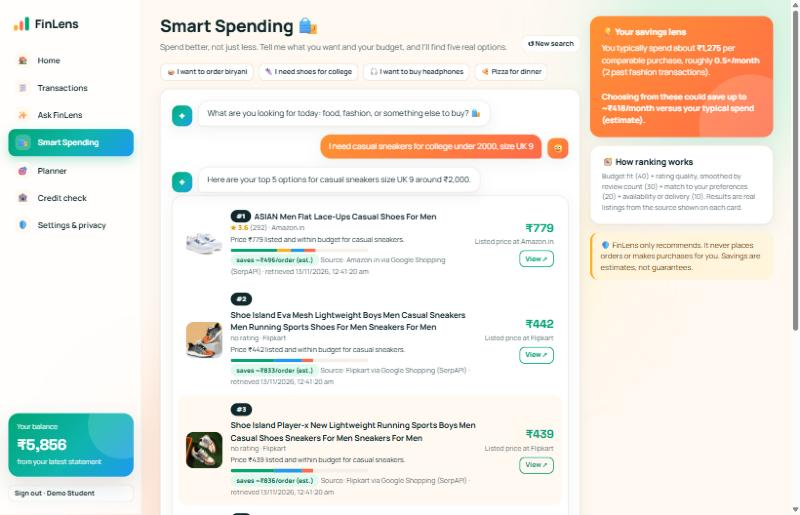
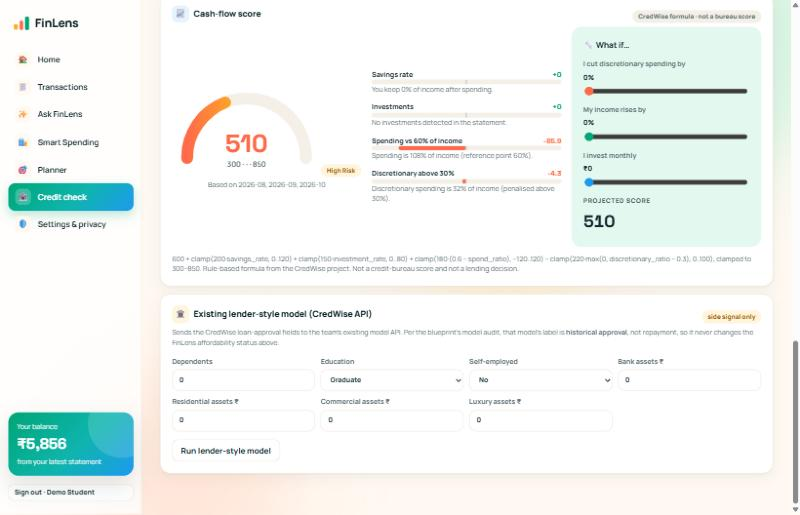
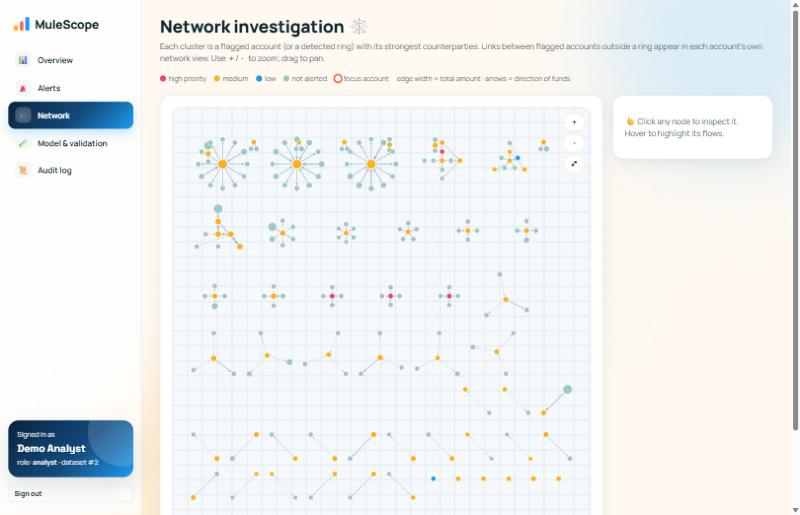
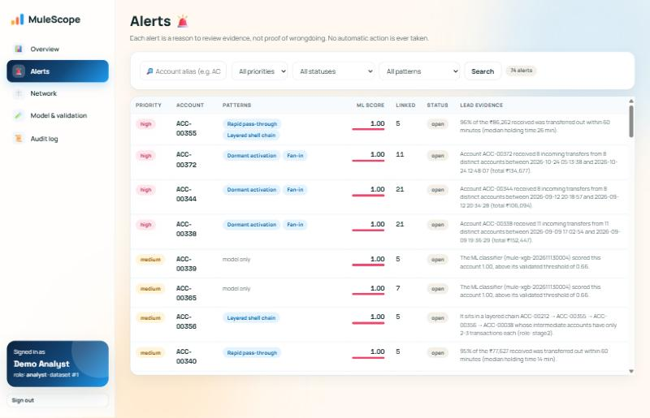
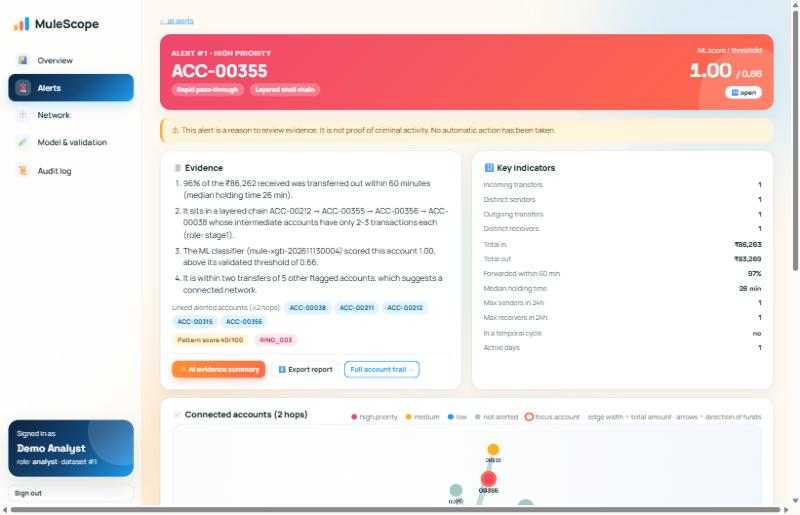

<div align="center">

# 💸 FinLens & 🕸️ Money Mule Detection

**Help people understand their money. Help institutions investigate suspicious money.**

ZeroHour · Track 1 (Quantitative Finance, FinTech & Risk Analytics) · Team **CodeBlooded**

`Python 3.13` · `FastAPI` · `React 18 + Vite` · `XGBoost / scikit-learn` · `NetworkX` · `Cytoscape.js` · `Recharts` · `Groq LLM` · `SerpAPI`

</div>

---

Two **independent** fintech products built from the project blueprint. They share engineering code but **no customer data, logins, databases or encryption keys**.

| | 💸 **FinLens** (B2C) | 🕸️ **Money Mule Detection: MuleScope** (B2B) |
|---|---|---|
| **For** | Students, young professionals, individuals | Banks, fraud analysts, compliance teams |
| **Does** | Spending insights, AI explanations, smart-spending recommendations, savings planning, cash-flow credit affordability | Multi-account transaction monitoring, graph and temporal pattern detection, explainable alerts, human-in-the-loop investigation |
| **API** | `finlens/` → <http://localhost:8001/docs> | `mule/` → <http://localhost:8002/docs> |
| **UI** | <http://localhost:5173/finlens> | <http://localhost:5173/institution> |
| **Store** | `data/stores/finlens.db` (own key) | `data/stores/mule.db` (own key) |

> ⚠️ **Prototype, decision support only.** It is not a registered Account Aggregator, lender, adviser or bank system. All demo data is **synthetic** and labelled as such. Model metrics come from synthetic data and **do not** prove real-world performance.

---

## 📸 Screenshots

| FinLens dashboard | Ask FinLens (verified figures) |
|---|---|
|  |  |
| **Smart Spending (live listings)** | **Credit check: cash-flow score + what-if** |
|  |  |
| **MuleScope overview** | **Network investigation (clusters)** |
|  |  |
| **Alerts** | **Alert evidence** |
|  |  |

---

## 🚀 Quick start

### Prerequisites
- **Python 3.13** (3.11+ should work) and **Node.js ≥ 18**
- Optional: a **Groq API key** (LLM) and a **SerpAPI key** (live shopping and restaurant search). Without them the app still works, with template answers and a labelled demo catalog.

Full details: [`docs/REQUIREMENTS.md`](docs/REQUIREMENTS.md).

### 1. Install

```bash
python -m pip install -r requirements-dev.txt
```

```bash
npm --prefix frontend install
```

### 2. Configure

Copy `.env.example` to `.env` and fill in what you have:

```ini
GROQ_API_KEY=your_groq_key
SERP_API=your_serpapi_key
```

### 3. Run everything (Windows, one command)

```bash
powershell -ExecutionPolicy Bypass -File .\start.ps1
```

On first run this generates the synthetic data, trains the models, starts both APIs and the frontend, and opens the browser.

<details>
<summary>…or start each service manually (any OS)</summary>

```bash
python -m ml.generate_finlens_samples && python -m ml.train_mule_model && python -m ml.train_credit_model
```

```bash
python -m uvicorn finlens.main:app --port 8001
```

```bash
python -m uvicorn mule.main:app --port 8002
```

```bash
npm --prefix frontend run dev
```

Open <http://localhost:5173>.
</details>

### 4. Log in

| Portal | Login |
|---|---|
| FinLens | Click **Create account** (any email/password), or use the demo account in [`data/samples/DEMO_ACCOUNTS.md`](data/samples/DEMO_ACCOUNTS.md) |
| MuleScope | `analyst` / `analyst-demo-2026` or `lead` / `lead-demo-2026` (change via `.env`) |

---

## 🎬 Demo walkthrough

**FinLens** (blueprint §14):
1. Create an account, grant **Spending analytics** consent, then **Try the synthetic sample statement** (or drop your own CSV/PDF).
2. **Home:** balance, inflows/spending, category donut, safe-to-spend maths, recurring payments, month-end forecast, spending calendar, and a grounded insight. For example: *"food delivery: 4 → 10 orders, average order unchanged"*.
3. **Ask FinLens:** "Why am I running out of money?" The answer is formatted, and every ₹ figure is verified against backend facts.
4. **Smart Spending:** "I want chicken biryani under 300, delivery". You get five real listings with links, a ranking breakdown and estimated savings.
5. **Planner:** add a goal (e.g. Laptop ₹40,000) to see the required monthly amount and alternative plans; use **planned-purchase check** for what-if purchases.
6. **Credit check:** grant the separate credit consent, then drag the EMI sliders and choose **Assess affordability** to see the status, five stress tests, factors, the cash-flow score with what-if, and the optional lender-model panel.

**MuleScope:**
1. Log in as `analyst`, then **Use synthetic demo dataset**. About 8,400 transactions are normalised and turned into an account graph, then rules, the ML model and graph analytics run.
2. **Overview:** volumes, rule families, **fraud-ring candidates**, **Export JSON**, and the **live feed** (choose **Replay synthetic stream**, or connect to the mr-mule WebSocket).
3. **Alerts**, then open a **high** alert: evidence sentences, indicators, AI evidence summary, 2-hop network rings, timeline, notes and status.
4. **Network:** separate clusters per flagged account or ring (stars, chains, cycles).
5. Log in as `lead` to record final dispositions, reveal a real account identifier (with a logged reason) and view the **Audit log**.
6. Optional: on Overview, upload `data/samples/mule_demo_labels_for_evaluation.csv` to measure precision, recall and false-positive rate.

---

## ✨ Features

### 💸 FinLens

| Capability | Highlights |
|---|---|
| **Ingestion** | CSV (auto column mapping, Type+Amount or Debit/Credit), **PDF via PyMuPDF + pdfplumber** (tables, bank lines, UPI-app statements), de-duplication, reversal netting, encrypted storage |
| **Categorisation** | 8 blueprint categories plus *Uncertain*; **credits are not automatically income** (refund, own-transfer, borrowed and P2P are separated); user corrections stick per merchant |
| **FinLens AI** | Dashboard metrics, month-to-date like-for-like changes with count-vs-value breakdown, recurring detection, safe-to-spend, forecast with 80% range, goals planner |
| **Ask FinLens** | The backend picks and computes metrics, then the LLM explains. **Every ₹ figure is verified**; on a mismatch the model gets 3 tries, then a template answer. Formatted Markdown answers, chat-only scrolling |
| **Smart Spending** | Conversational slot filling, live **Google Maps / Google Shopping** via SerpAPI (cached, timestamped, linked), top-5 ranking (budget 40 · rating 30 · preference 20 · availability 10), savings estimates, never purchases |
| **Credit Intelligence** | Cash-flow features, reducing-balance EMI and schedule, affordability rule, **5 stress tests**, status + factors + illustrative loans, risk-band model (side signal), **CredWise 300–850 score with what-if**, optional existing-loan-API bridge with caveat |
| **Privacy** | Per-purpose consent, Fernet encryption at rest, minimal LLM context, delete data / delete account |

### 🕸️ Money Mule Detection

| Layer | Details |
|---|---|
| **Rules** | Fan-in/out (24h), rapid pass-through (≥80% forwarded within 60 min), temporal cycles (≤5 hops, ≤72h), amount splitting (₹45k–50k), dormant activation, velocity spikes. From **MuleGuard**: layered shell chains, 72h smurfing, high-volume-merchant false-positive suppression |
| **ML** | XGBoost on 20 account features; threshold from ring-aware out-of-fold predictions |
| **Graph** | PageRank, clustering, linked alerts within 2 hops, fraud-ring candidates with risk scores |
| **Prioritisation** | **No score averaging.** *High* = ML ≥ threshold **and** ≥2 rule families; *medium* = either; *low* = 1 rule family and ML ≥ ½ threshold |
| **Investigation** | Evidence sentences, AI summary (neutral), ego graph, account trail, timeline, notes, status workflow (final dispositions are lead-only), Markdown report, JSON export, audit log, aliased IDs with lead-only reveal |
| **Live** | WebSocket ingest compatible with **mr-mule** (`transaction_id,sender_id,receiver_id,amount,timestamp`), incremental re-analysis that keeps analyst work |

---

## 🏗️ Architecture

```
            ┌──────────────────────── React (Vite :5173) ────────────────────────┐
            │      /finlens/* (green UI)                /institution/* (blue UI)   │
            └──────────┬───────────────────────────────────────────┬─────────────┘
                 /x-fin proxy                                /x-inst proxy
                       │                                           │
   ┌───────────────────▼──────────────────┐   ┌────────────────────▼────────────────────┐
   │ FinLens API (FastAPI :8001)          │   │ Money Mule API (FastAPI :8002)          │
   │ ingestion → categoriser → analytics  │   │ normalise → graph + temporal features   │
   │ assistant (Groq) · smart spending    │   │ rules + MuleGuard patterns + XGBoost    │
   │ (SerpAPI) · credit (EMI/stress/ML)   │   │ rings · alerts · notes · audit · live   │
   │ consents · encryption                │   │ roles · aliases · encryption            │
   └───────────────────┬──────────────────┘   └────────────────────┬────────────────────┘
              finlens.db (own key)                         mule.db (own key)
                       └──────── shared/ : CODE ONLY (validation, crypto, LLM client) ┘
```

**Separation rules (blueprint §08):** separate databases, secrets and encryption keys; tokens carry an audience and are rejected by the other API (tested); no AML signal can reach the credit module.

---

## 📊 Measured results (synthetic data)

| Module | Result | How measured |
|---|---|---|
| Mule classifier (XGBoost) | **PR-AUC 0.967**, precision 0.82, recall 0.97, FPR 2.5% | Held-out synthetic scenario (different seed, accounts and rings) with hard negatives (salary sweeps, group collections, small businesses, merchants) |
| Rules-only baseline / LogReg baseline | PR-AUC 0.25 / 0.81 | Same held-out set |
| Credit risk band (LogReg chosen) | ROC-AUC 0.80, PR-AUC 0.29 vs 0.06 constant baseline, Brier 0.049 | Temporal split (months 1–18 → 19–24), **simulated repayment** label |
| Categoriser | 45/45 on a small self-written labelled set | Optimistic; real labelled data needed |

Model cards: [`docs/MULE_MODEL_CARD.md`](docs/MULE_MODEL_CARD.md) · [`docs/CREDIT_MODEL_CARD.md`](docs/CREDIT_MODEL_CARD.md). Retrain anytime:

```bash
python -m ml.train_mule_model
```

```bash
python -m ml.train_credit_model
```

---

## 🔌 API overview

Interactive docs: <http://localhost:8001/docs> and <http://localhost:8002/docs>.

<details>
<summary><b>FinLens API</b> (port 8001)</summary>

| Method | Path | Purpose |
|---|---|---|
| POST | `/api/auth/register`, `/api/auth/login` | Consumer accounts |
| GET / POST / PUT | `/api/me`, `/api/consents`, `/api/settings` | Profile, per-purpose consent, buffer/opening balance/commitments/location |
| POST / GET | `/api/statements` | Upload CSV/PDF · list uploads |
| GET / PATCH | `/api/transactions`, `/api/transactions/{id}/category` | List/filter · correct category |
| GET | `/api/dashboard`, `/api/forecast`, `/api/categories` | Metrics, forecast |
| POST | `/api/whatif` | Planned-purchase check |
| GET / POST / PATCH / DELETE | `/api/goals[/{id}]` | Savings goals |
| POST | `/api/ask` | Grounded Q&A (with figure verification) |
| POST | `/api/spending/message`, `/api/spending/reset` | Smart Spending conversation |
| POST / GET | `/api/credit/assess`, `/api/credit/score`, `/api/credit/lender-model`, `/api/credit/emi` | Affordability, cash-flow score, existing-model bridge, EMI |
| DELETE | `/api/data`, `/api/account` | Delete data / account |
| GET | `/api/meta`, `/api/sample-statement` | Config status, synthetic sample |
</details>

<details>
<summary><b>Money Mule API</b> (port 8002)</summary>

| Method | Path | Purpose |
|---|---|---|
| POST / GET | `/api/auth/login`, `/api/me` | Investigator login (analyst / lead) |
| POST / GET / DELETE | `/api/datasets[/{id}]` | Upload and analyse · list · delete (lead) |
| POST | `/api/datasets/live`, `/api/datasets/{id}/append` | Live feed ingest |
| GET | `/api/datasets/{id}/overview`, `/alerts`, `/rings`, `/graph`, `/export.json` | Investigation views and export |
| GET | `/api/datasets/{id}/accounts/{alias}` | Account trail |
| POST | `/api/datasets/{id}/accounts/{alias}/reveal` | Lead-only real-identifier reveal (audited) |
| GET / POST | `/api/alerts/{id}`, `/notes`, `/status`, `/summary`, `/report` | Alert evidence, case work, AI summary, report |
| POST | `/api/datasets/{id}/evaluate` | Precision/recall vs a labels CSV |
| GET | `/api/audit`, `/api/meta`, `/api/sample-dataset` | Audit log (lead), model metrics, synthetic sample |
</details>

---

## 📁 Project structure

```
PESHACK1/
├── finlens/              B2C API: ingestion, pdf_statement, categorizer, analytics,
│                         assistant, smart_spending, search, credit, credit_features, db
├── mule/                 B2B API: features (rules/graph), patterns (MuleGuard port),
│                         detection (3 layers), db
├── shared/               Code-only foundation: config, security (PBKDF2, tokens, Fernet),
│                         normalize, llm (Groq client), dbutil (SQLite WAL / Postgres)
├── ml/                   Synthetic data generators + training scripts
│   └── artifacts/        Trained models + metrics JSON (committed)
├── frontend/             React 18 + Vite + Recharts + Cytoscape (FinLens + MuleScope)
├── data/
│   ├── samples/          Synthetic CSV/PDF statements, mule demo data + labels, demo accounts
│   ├── generated/        Regenerable training data (git-ignored)
│   └── stores/           Runtime databases (git-ignored)
├── tests/                36 pytest tests
├── docs/                 REQUIREMENTS, model cards, reference integration, screenshots
├── reference/            Read-only clones of the team's repos (git-ignored)
├── requirements.txt      Pinned runtime deps · requirements-dev.txt adds pytest
├── start.ps1             One-command launcher (Windows)
└── .env.example          Configuration template
```

---

## 🧪 Testing

```bash
python -m pytest
```

The 36 tests cover:
- EMI and amortisation maths, safe-to-spend (the blueprint example equals ₹3,000)
- ingestion (duplicates, reversals, credit kinds, both CSV layouts, three PDF layouts with PyMuPDF and pdfplumber)
- traceable totals, categorisation, consent gates, category corrections, goals, credit status and stress tests
- the Smart Spending conversation, the figure verifier, and token separation between products
- mule rules (fan-in, pass-through, temporal cycles, shell chains, smurfing), priority rules, rings and JSON export, live append, roles, identifier reveal and the audit log

Tests run offline: API keys are disabled inside the test session.

---

## 🧩 Reuse of the team's existing projects

| Repo | What was reused |
|---|---|
| [`muleguard`](https://github.com/SamratSK/muleguard) | Shell-chain, smurfing and merchant-suppression detectors, ring risk scoring, JSON export format, live mode, Cytoscape layout approach |
| [`mr-mule`](https://github.com/SamratSK/mr-mule) | Live WebSocket CSV feed, accepted directly by MuleScope's live ingest |
| [`cred-wise`](https://github.com/SamratSK/cred-wise) | 300–850 cash-flow score with what-if, UPI-PDF parsing heuristics, spending heatmap, bridge to its loan-model API (with a historical-approval caveat) |

None of the repos contained trained model files or datasets, so both models were trained on clearly labelled synthetic data. Details: [`docs/REFERENCE_INTEGRATION.md`](docs/REFERENCE_INTEGRATION.md).

---

## 🛡️ Responsible AI and limits

- The **LLM never calculates.** It explains backend facts, and every ₹ figure in an answer is checked.
- Smart Spending shows **retrieved listings only** (or a clearly labelled demo catalog), with sources and timestamps. It never orders anything.
- Credit output is an **estimate, not an approval**. The model's label is disclosed, and no AML data is ever used.
- Mule alerts are **reasons to review**, not findings. There is no automatic freezing, and humans record every final disposition.

**Not claimed:** bank login with passwords, automatic purchases, account freezing, guaranteed loans, banking partnerships, or production accuracy from synthetic data.

---

## 🛠️ Troubleshooting

| Symptom | Fix |
|---|---|
| Ask FinLens shows "template answer" | `GROQ_API_KEY` is missing or the free-tier rate limit was hit (the client already retries); wait a few seconds |
| Smart Spending shows **DEMO** cards | `SERP_API` is missing, its quota is used up, or there were no live results |
| "No transactions yet" | Upload a statement after granting the **Spending analytics** consent |
| PDF rejected | Scanned/image PDFs have no text layer; export a CSV from your bank |
| Schema changed after an update | Stop the APIs and delete `data/stores/*.db*` (dev data only) |
| Port in use | Change `--port` (and the proxy targets in `frontend/vite.config.js`) |

---

<div align="center">

Built for **ZeroHour (PES University)** by **Team CodeBlooded** from BMSCE, RVCE and IIIT-B.

</div>
